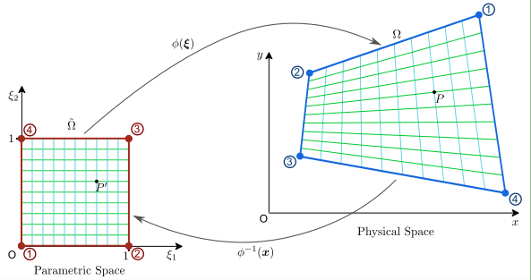

# [[Paper]](https://doi.org/10.1016/j.advengsoft.2025.103975)

# Inverse Mapping Algorithm for Bilinear Interpolation of Quadrilaterals
A powerful C library for finding the parametric co-ordinates of bilinear mapping for any given point with respect to a quadrilateral. These parametric co-ordinates are also utilised in calculating the interpolation functions or shape functions at the given point. The library also helps in evaluating the Barycentric co-ordinates of a point in case of a triangle.

# Overview
Given a point and a quadrilateral in the physical space, the function $\phi^{-1}(x)$ defines the inverse mapping to a corresponding point in the parametric space. The algorithm calculates the parametric co-ordinates $(\xi_1,\xi_2)$ corresponding to the given point $(x,y)$ in the physical space through this inverse mapping.



# Features
* Compute parametric coordinates for any given point with respect to a bilinear quadrilateral.
* Calculate interpolation functions (shape functions) at a given point.
* Evaluate Barycentric coordinates for points within triangles.
* Analytical solution that avoids convergence issues commonly encountered in iterative schemes.
* Approximately 2.4 times faster than Newton’s iterative method for quadrilaterals with non-parallel opposite sides.

## Installation
To install the library, simply clone this repository and include the header files in your project. Make sure to link the library during compilation.

`git clone https://github.com/sahu-indrajeet/Bilinear-Inverse-Mapper`

Refer to examples in this repository for a quick guide on this library's utility. 

### Citation

If you find this library useful, please cite:

> **Sahu, I.** (2025). *Bilinear-inverse-mapper: Analytical solution and algorithm for inverse mapping of bilinear interpolation of quadrilaterals*. *Advances in Engineering Software*, **208**, 103975.

---

Or use this BibTeX entry:

```bibtex
@article{sahu2025bilinear,
  title={Bilinear-inverse-mapper: Analytical solution and algorithm for inverse mapping of bilinear interpolation of quadrilaterals},
  author={Sahu, Indrajeet},
  journal={Advances in Engineering Software},
  volume={208},
  pages={103975},
  year={2025}
}
